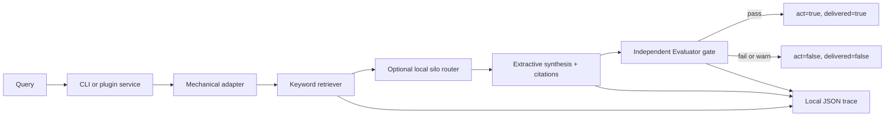

# Gate-Enforced RAG: Technical Overview

This document explains the engineering behind `gate-enforced-rag` for a technical recruiter, hiring manager, or future collaborator. It describes what is built today, why the design favors reproducibility and auditability, and what would need to change before this became a production system with live models and external data.

## Executive summary

`gate-enforced-rag` is a small retrieval-augmented generation (RAG) system whose answer cannot be delivered until it passes an independent Evaluator gate. It retrieves relevant passages from public fixture corpora, builds an extractive answer with citations, evaluates that answer against the project contract, and exposes both the verdict and delivery decision as structured data.

The project deliberately uses a mechanical implementation rather than a live language model. That makes the reliability boundary observable and testable on every machine and in CI. The central question is not only "can the system produce an answer?" but also "can the system reliably refuse to ship an answer that violates its evidence or policy?"

Current status: Phase 5, using portfolio-kit contract version 0.1.0.

## The problem

A conventional RAG pipeline often looks like this:

1. Retrieve documents.
2. Ask a model to synthesize an answer.
3. Return the answer.

That shape has a dangerous implicit assumption: generation is treated as delivery. Retrieval quality, citation coverage, policy compliance, and contradictions may be imperfect, but the system still emits a response.

This project separates **generation** from **delivery**. An answer is an intermediate artifact. Delivery is a separate decision made by an Evaluator gate. A failed gate returns a structured refusal and keeps both `act` and `delivered` false.

This is a portfolio-scale reliability experiment, not a claim that a small fixture corpus is production search infrastructure. Its value is that the safety and quality boundary is concrete enough to inspect, test, and explain.

## What RAG means here

RAG combines information retrieval with answer synthesis. In this implementation:

- **Retrieval** uses deterministic keyword matching over local Markdown fixtures.
- **Synthesis** is extractive: answer text is assembled from retrieved source snippets rather than invented by a model.
- **Citations** identify the source documents used by the answer.
- **Evaluation** checks evidence, citations, policy signals, trace completeness, and contradictions.
- **Delivery** is enabled only for a passing verdict.

The system is intentionally not a live LLM application. There is no model call, embeddings service, vector database, external crawler, or hosted telemetry dependency in the core path.

## Technology stack

| Layer | Technology | Why it is used |
|---|---|---|
| Runtime | Node.js 20+ | Stable standard-library runtime with a small operational footprint |
| Language | JavaScript ES modules | Direct, dependency-free implementation and clear module boundaries |
| Retrieval | Mechanical keyword retriever | Deterministic behavior that can be reproduced in CI |
| Corpus | Local public/synthetic Markdown fixtures | Safe, inspectable evidence without network or sensitive data |
| Synthesis | Extractive citation-preserving synthesis | Avoids pretending that a model generated facts it cannot support |
| Reliability | Evaluator verdict plus `act` / `delivered` contract | Makes the delivery boundary explicit and machine-testable |
| Adapters | CI-safe Haystack and LlamaIndex-shaped adapters | Exercises integration contracts without installing live frameworks |
| Routing | Local `contracts` and `ops` silos | Tests multi-source behavior and contradiction detection |
| Observability | Local JSON trace, `gate-enforced-rag.trace.v1` | Provides structured evidence without a telemetry service |
| Integration shape | Cordis-style `name` + `apply(ctx)` plugin | Makes the answer service embeddable without requiring dsh |
| Testing | Node `node:test`, fixture eval runner | Keeps validation fast, portable, and dependency-free |

## Architecture

The implementation is organized around a narrow flow:

- `src/retrieve.js` selects relevant local hits.
- `src/router.js` optionally searches multiple local silos and detects conflicting claim metadata.
- `src/answer.js` orchestrates retrieval, extractive synthesis, citation checks, refusal controls, and gate evaluation.
- `src/observe.js` creates and completes the local trace spans.
- `src/plugin.js` exposes the same gated answer function using a dsh/Cordis-shaped plugin contract.
- `index.js` is the package entry point.
- `eval/run.js` runs the held-out catalog and reports reliability metrics.

## Request lifecycle

### 1. Intake and refusal checks

The CLI or plugin accepts a query and options. Unsupported capabilities are rejected before work begins, including live LLM calls, live Haystack or LlamaIndex installation, remote federation, external telemetry, and GitHub writes.

This is an important boundary: unsupported behavior fails closed instead of silently degrading into an unverified path.

### 2. Retrieval

The mechanical retriever tokenizes the query and scores local fixture documents by keyword overlap. Each hit retains its document id, source metadata, silo, and claim metadata. Keeping this data attached to the hit makes later citation and contradiction checks possible.

### 3. Optional routing across silos

With multi-source mode enabled, the local router searches the `contracts` and `ops` fixture silos. It is not remote federation. When two sources make incompatible claims about the same topic, the router records a high-severity contradiction issue.

The contradiction is intentionally not resolved by choosing the most recent-looking or highest-scoring passage. The system refuses to act until the ambiguity is addressed.

### 4. Extractive synthesis

The synthesizer builds an answer from retrieved snippets and attaches citations. It does not produce unsupported prose through a hidden model call. Missing retrieval or missing citations becomes a gate issue rather than an invitation to guess.

### 5. Independent evaluation

The Evaluator inspects the candidate answer and its evidence against the local contract. Relevant checks include:

- Is there enough evidence to answer?
- Are citations present and tied to retrieved documents?
- Did a prohibited or sensitive request appear?
- Did the router find an unresolved contradiction?
- Is an observed trace complete when observation is requested?
- Did the request attempt an explicitly refused live capability?

The result follows the stable `gate-enforced-rag.answer.v1` shape. A passing verdict is required before delivery.

### 6. Delivery decision

The system separates the content from the decision to deliver it:

- `verdict`: `pass`, `warn`, or `fail`.
- `act`: whether the system is permitted to take the user-facing action.
- `delivered`: whether the answer is considered shipped.
- `citations`: evidence references for a passing answer.
- `issues`: structured reasons for refusal or warning.
- `trace`: optional local observability data.

Known-bad answers must never set `act` or `delivered` to true. The plugin service and registered tool call the same answer path, so embedding the service does not bypass the gate.

## Major design decisions

| Decision | Alternative considered | Why this choice | Consequence |
|---|---|---|---|
| Mechanical extraction first | Live LLM generation | A deterministic path makes evidence and refusal behavior testable without credentials, model drift, or GPU access | Less natural language and less model realism; stronger reproducibility |
| Fail closed before delivery | Return a best-effort answer with a warning | A warning is not a reliable boundary if downstream code still acts | Some ambiguous requests are refused instead of being answered |
| Shared portfolio-kit contracts | Invent a project-specific verdict schema | Shared contracts let sibling projects compare behavior and avoid a second gate language | Changes require compatibility discipline and versioning |
| Local public/synthetic fixtures | Live Wikipedia, arXiv, or employer data | Fixtures are safe to publish, stable in CI, and easy to inspect | Corpus breadth and freshness are limited |
| CI-safe framework-shaped adapters | Install Haystack/LlamaIndex packages immediately | The integration boundary can be exercised without network, Python environments, or dependency churn | The adapters prove shape and gating, not framework performance |
| Local JSON traces | Hosted OTEL, Prometheus, Jaeger, or Datadog | Structured local traces are sufficient to inspect the lifecycle and preserve offline execution | No central dashboards or fleet-level aggregation yet |
| Cordis-shaped standalone plugin | Require a live dsh installation | The `name` + `apply(ctx)` contract can be validated locally and embedded by future runtimes | Live dsh compatibility still needs an explicit integration check |
| Contradiction refusal | Pick one conflicting source automatically | Silent conflict resolution can turn inconsistent evidence into a confident answer | A human or later policy must resolve the disagreement |

The overall tradeoff is deliberate: **reproducibility and auditability are prioritized over model realism**. That is appropriate for demonstrating a reliability boundary and its evaluation evidence. A production rollout would add model and retrieval realism only after preserving the same contract and tests.

## Relationship to Meridian and portfolio-kit

The repositories in this family share a reliability design, but they are not one deployed application.

- **Meridian** is the original reliability spine and source of the gate, Evaluator, and memory concepts.
- **portfolio-kit** versions the shared contracts, schemas, evaluation rubric, and public-data policy at contract version 0.1.0.
- **gate-enforced-rag** is a standalone consumer of those contracts. It does not require Meridian's runtime, a `.meridian/` directory, or a live dsh process.

This distinction is an architectural choice. The project can demonstrate the behavior locally while still remaining compatible with the broader family. It reuses the contract rather than pretending that every sibling must import the same runtime implementation.

## Plugin integration

The package exports `name`, `apply(ctx)`, `createService`, and the answer API from `index.js`.

A host can provide:

- `ctx.provide(key, service)` to register the service in a Cordis-like context.
- `ctx.registerTool(definition, handler)` to expose the gated answer operation.
- `ctx.emit(event, payload)` to receive `rag.answer` events.
- `ctx.logger.info(message)` for a load message.

Without those host methods, the service still attaches to `ctx.gateEnforcedRag` and remains callable as a normal Node object. This lets tests validate the integration contract without booting a full external harness.

## Evaluation and evidence

The project uses two complementary checks:

1. **Unit and contract tests** verify answer behavior, adapters, refusals, routing, contradictions, traces, plugin registration, and non-delivery of rejected answers.
2. **Held-out catalog evaluation** runs the `GER-001` through `GER-028` cases and computes portfolio-kit metrics.

Current measured evidence on 2026-09-04:

- `npm test`: 12 tests passing.
- Golden set: 28 cases.
- D3 gate-catch rate: `1.0` across 18 known-bad cases.
- Verdict agreement: `1.0`.
- Known-bad no-act rate: `1.0`.

These numbers demonstrate the behavior of the mechanical fixture system. They do not claim production-scale retrieval quality, broad-world factual coverage, or live model quality.

## Security and data boundaries

The repository is public and uses only public or synthetic fixture material. It explicitly excludes employer, JPO, F-35, and other non-public program data.

The implementation refuses or excludes:

- GitHub writes, comments, and issues.
- Live LLM calls and model downloads.
- Live Haystack/LlamaIndex installation.
- Remote Wikipedia/arXiv federation.
- Hosted telemetry exports.
- A hidden path that delivers a failed answer.

The refusal behavior is tested rather than left as README-only policy. Sensitive local material remains outside this repository and must not be copied into fixtures, examples, or eval cases.

## Limitations

This is not yet a production RAG service. Important limitations include:

- Keyword retrieval is shallow compared with embeddings or learned reranking.
- The corpus is small, local, and synthetic/public.
- Extractive synthesis is intentionally less expressive than an LLM.
- The plugin has a dsh-compatible shape but has not been validated by installing and booting a live dsh runtime.
- Local JSON traces are useful for inspection but do not provide distributed observability.
- The evaluation set is curated for this project and should grow before making broader quality claims.

## How I would evolve it

A responsible next sequence would preserve the current answer schema, refusal controls, and eval gates while adding realism incrementally:

1. Add a versioned retrieval interface and benchmark a real local index against the mechanical baseline.
2. Add an optional model-backed synthesizer behind an explicit capability flag, with the same independent gate and citation requirements.
3. Add a controlled external-source adapter with source freshness, provenance, timeout, and failure tests. Federation should remain disabled by default.
4. Run the live dsh plugin installation check and document the supported host lifecycle.
5. Expand the held-out evaluation set with adversarial omissions, citation mismatches, stale sources, and cross-silo conflicts.
6. Add hosted telemetry only after the local trace schema is stable and privacy boundaries are documented.

The project should not add those capabilities by weakening the current boundary. The intended evolution is to make the generator and retrieval layers more realistic while keeping evaluation, provenance, and delivery authorization independent.

## Talking points

For an interview or portfolio discussion, the core story is:

- I built a RAG pipeline where retrieval and answer generation are not equivalent to delivery.
- I made the quality boundary mechanical and inspectable instead of relying on a model to grade itself.
- I designed the system to fail closed on missing evidence, prohibited requests, contradictions, and unsupported live integrations.
- I used local fixtures and zero dependencies so the behavior is reproducible in CI.
- I measured the refusal behavior with a held-out catalog rather than presenting a demo as proof.
- I kept the integration surface compatible with a plugin host while allowing standalone testing.
- I can explain exactly what is implemented today and which production capabilities remain future work.
