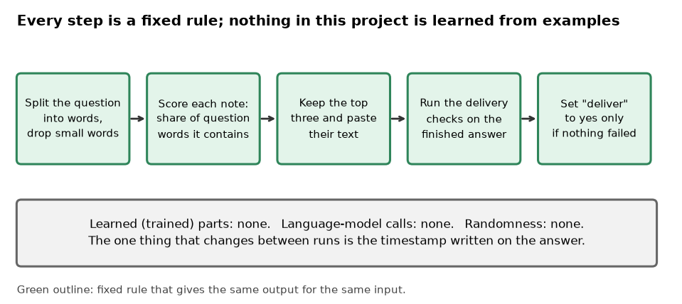
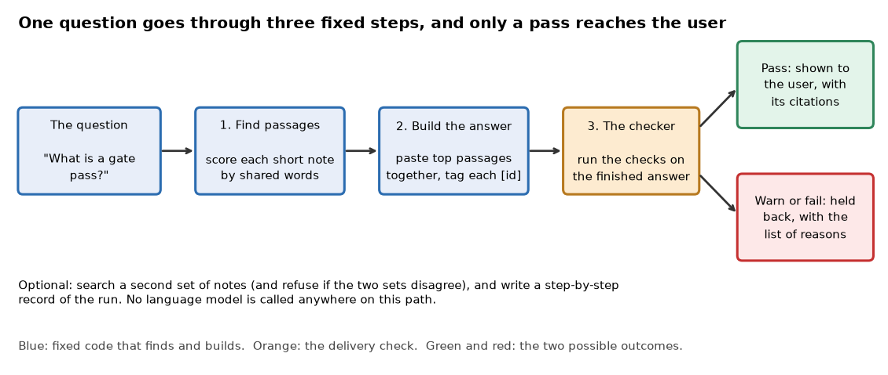
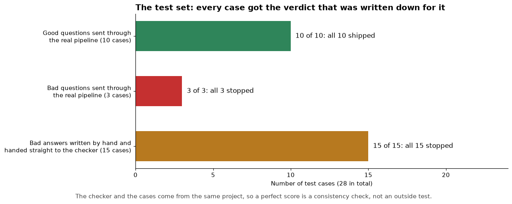

# gate-enforced-rag

*A small question-answering program built so that its answer cannot reach the user until a separate checker has approved it.*

Status: a working prototype at version 0.1.0, last changed in September 2026. Code: https://github.com/PCSchmidt/gate-enforced-rag (public, MIT (Massachusetts Institute of Technology) licence, a permissive open-source licence). It has no stars, no copies made by others, and no outside users that I can show.

Imagine an office assistant that answers staff questions from the company handbook. It answers fluently, cites nothing, and sometimes answers a question the handbook never covers. Most systems like this write the answer and hand it over in one step, perhaps with a warning attached. I built gate-enforced-rag to pull those two steps apart. The program finds passages in a small set of notes and pastes them into a draft answer, with a citation (a note saying which document each piece came from). Then a separate checker reads the draft. The draft is delivered only if the checker finds nothing wrong. Otherwise the user gets a list of reasons and no answer.

A gate is a checkpoint that must be passed before something moves on; here, delivery to the user is the gate. The checker's decision is called the verdict: "pass", "warn" or "fail". Only a pass delivers. AI coding agents wrote almost all of the code, and I directed the scope, plan, architecture and preferences.

This is a reliability experiment, not a product. It does not use an AI language model (software trained on huge amounts of text) at all. It copies the retrieved passages word for word, so every behaviour is a fixed rule that can be tested the same way every time.

One limit matters more than any other, and I state it here once. The checker confirms that an answer carries citations that exist, but it does not confirm that the cited passages are relevant to the question. Ask it about a parking garage and it can confidently deliver an answer about software gates. The rest of this guide refers back to that gap.

If you have ten minutes, read this opening and the chapters on what it does, the results, and the one for recruiters and interviewers.

Here is what is fixed and what is learned. A calculator is deterministic: the same input always gives the same output. A weather forecast is probabilistic: a best guess that can be wrong. This project is entirely a calculator. It has no model trained on examples, no call to a language model, no random sampling and no network access. Finding passages is counting shared words, building the answer is pasting text together, and the checker is a list of if-then rules. Running the same question twice gives identical results apart from a timestamp, and repeated runs of the whole test set gave identical reports. But identical output proves the program is repeatable, not that it is right. A fixed rule can be wrong the same way every time.



## What problem this solves

Take the handbook assistant again. A staff member asks, "Do I need approval to use outside data?" The assistant cites a document it never read, or answers a question the handbook does not cover, and because the answer looks confident the person acts on it.

The usual fixes are to ask the writer to be careful or to add a disclaimer. The weakness is that the component that wrote the answer also decides whether it is good enough. My answer is to give the delivery decision to a different part of the program and make that part fail closed: when in doubt, it says no. A missing citation, an empty search or an unexpected option then results in nothing being delivered, not in a best guess.

This kind of program is called RAG (retrieval-augmented generation): it first retrieves (looks up) relevant passages and then generates (writes) an answer from them. Toolkits such as Haystack (an open-source toolkit for building search and question-answering programs) and LlamaIndex (a similar toolkit that connects documents to language models) are far better than this project at getting good answers. This project is about what happens before an answer is allowed out.

The stated goal is narrow: a known-bad answer must never be marked as deliverable, and the test cases check that. There is no goal for answer quality, so no quality measure exists.

The code refuses several things when asked: calling a live language model, installing Haystack or LlamaIndex, fetching pages from Wikipedia or arXiv (a public archive of research papers), sending data to monitoring services, or writing to GitHub. The documents it searches are short invented summaries paraphrased from the shared rules of my other projects, so no non-public data is involved. Defense-sector topics interest me, but nothing in this repository claims any such use.

The project belongs to a family of mine built on one idea, "systems checked before they are trusted". It borrows the gate idea from Meridian, my project that keeps AI coding agents from claiming work is done until checks pass, and it reuses shared written rules from a sibling repository of mine called portfolio-kit. It does not run Meridian's code.

## What it does, step by step

A person types a question, or other code calls the program. Here is one complete example from the project's own sample input: "What is a gate pass?"

First, the program splits the question into lower-case words and drops short words and filler such as "what", "is" and "the". That leaves "gate" and "pass". Second, it scores each of its four short notes by the share of those words the note contains. The note about the gate rules has both, so it scores 1.0. The note about the evaluator (a separate program that grades an answer and returns a verdict) has "pass" but not "gate", so it scores 0.5. The note about citations has "gate" but not "pass", so it also scores 0.5. The note about data policy has neither and is dropped. Third, the program keeps up to the top three, pastes their text together, and tags each piece with its source, for example [gate-contract], along with a short quote.

Fourth, the checker runs its rules on the draft. Nothing is wrong, so the verdict is "pass" and the result's two fields, "act" and "delivered", are set to true. The user sees the answer with three citations. Had a serious rule failed, the verdict would be "fail", both fields would be false, and the result would hold a list of coded reasons instead of an answer.



The best everyday comparison is a newspaper copy desk. A reporter hands in a story, and an editor who did not write it decides whether it runs. The comparison breaks down in one important way. A human editor judges whether the story is good, while this checker mostly confirms that the paperwork is in order: citations exist, forbidden words are absent, no unexpected options were used.

Its realistic users are developers who want to study or copy the pattern, for example someone building an internal question-answering tool who wants a worked example of a delivery check with tests. They run it from a terminal or import it into their own Node.js code (Node.js runs JavaScript programs outside a web browser). Everything is automatic; there is no human approval step, and the only person in the loop is whoever reads the result. A team wanting answers from real company documents or a real language model would not be served: that is refused by design. Any serious use in a government setting would also need approved data handling, access control and far better retrieval, none of which exist.

In short, a question becomes a pasted-together, cited draft, and a rule-based checker decides whether the draft may leave.

## How it works: parts, data and tools

The program has five parts, each with one job. The finder scores and picks passages. The builder pastes them into a draft with citations. The checker applies the rules and sets the delivery fields. An adapter, which sounds grander than it is, only picks a label and a list of stage names to write on the answer, such as "document store, retriever, prompt builder, evaluator"; choosing the "Haystack" or "LlamaIndex" option does not load either toolkit, and the checker merely requires that label and flag agree. A router, which is optional, searches a second silo (a separate set of notes) as well and notices when the two silos contradict each other. Two extras sit beside these: a recorder that can write a step-by-step trace of a run as plain data, and a plugin wrapper that lets other code call the whole thing.

Four rules must never break: nothing is delivered without a passing verdict; nothing with a high-severity problem (the checker marks each problem high or medium) passes; a self-given score never counts as a pass; and the forbidden features (live language model, GitHub writes, outside archives, outside monitoring, live toolkits) never run. The first rule is enforced in one place, where the checker computes the delivery fields from its list of problems. The forbidden features are stopped at the entry points, which end with an error before any work starts.

The data is four short notes in the main silo and two in the second. They are invented summaries of shared rules from my other projects: what a gate is, what an independent evaluator returns, which data is allowed, and the rule that answers must cite their sources. The second silo holds a note on allowed public stand-in data and one deliberately wrong note, which claims that a program grading its own work counts as an independent pass. That note exists to test the contradiction check. The notes carry no personal or sensitive data, and the project records where each was paraphrased from.

The tools are few. The language is JavaScript on Node.js version 20 or later, using only what Node.js ships with, so nothing is installed. Tests use Node's built-in test runner. CI (Continuous Integration), an automatic service that runs the tests every time new code is pushed to GitHub, runs the tests and the evaluation too. JSON (JavaScript Object Notation), a plain-text way of writing structured data, carries answers and traces. The alternatives, such as Python with a search library or an index of embeddings (lists of numbers that capture a passage's meaning), are not used; the project's written rules forbid installs and network access.

Everything lives in memory for one run, so a crash loses nothing. If a step fails unexpectedly, the program stops with an error and delivers nothing. The weakest link is retrieval, because counting shared words says little about meaning. With 100 times more notes the finder would slow down, since it compares every note on every question, and accidental word overlaps would produce more false matches.

## The methods, and why no models

Three methods matter. The first is keyword scoring. The score is the number of question words found in a note divided by the number of question words. For "gate pass", a note with both words scores 2 out of 2, or 1.0, and a note with one scores 0.5. It does no stemming (reducing "passed" to "pass"), so those are different words. BM25 (Best Matching 25) is a standard ranking formula that favours rare words, and embedding search compares meaning instead of words. Either would find relevant notes that use different wording, but they cost installs, models or tuning. Word counting fails when a question shares common words with an unrelated note, which is exactly the relevance gap described in the opening.

The second is the fixed-rule checker, a list of about twenty checks. Any high problem makes the verdict "fail"; only medium problems make it "warn"; none makes it "pass". Only a "pass" delivers, so a warning is withheld too. One medium rule is a relevance floor: if even the best note scores below 0.34, the answer is held back. Toy example: for "capital france gate", three words, only "gate" matches, so the best score is 1 out of 3, or 0.333. That is just under 0.34, so the verdict is "warn" and nothing is delivered. The documents do not explain the 0.34 threshold. The score is a fraction of words matched, not a probability, and nothing in the project says how often a score of 0.5 means a note is on topic.

The third is the contradiction check. Each note can carry a hand-written label such as "topic: self-grading counts as a pass, value: false". When the second silo is used, the program gathers the labels from the retrieved notes, and if two give different values for the same topic it records a high-severity problem. Because the labels are attached by hand, it detects only conflicts that someone has already labelled.

The maths is no more than a fraction and a cut-off. The project reports no confidence or probability, so there is no calibration question. The match score, if you want it as a formula, is (question words found in the note) divided by (question words kept after dropping filler, where a repeated word counts each time).

The project uses no model. With a model writing the answers, a test could not expect the same text every time; by pasting source text, the delivery check can be tested on its own. The price is that nothing here shows how the check would cope with a model's fluent, subtly wrong prose, which is the harder case. Because text is copied, the program cannot invent words; the remaining risk is not made-up text but the wrong choice of real text. With no model there are no prompts, model costs or paid calls to track.

## Testing and safeguards

Small attacks tried in a scratch copy outside the repository gave mixed results. The simple refusals hold. An empty question, or words found nowhere, fails with "no corpus hits". A question matching only 2 of 8 words is held back as weak retrieval. An answer carrying a self-score or a made-up citation fails. Asking for a live model, a GitHub write, outside archives or monitoring stops with an error, as does choosing both toolkit adapters at once. A forbidden program name in a question fails the forbidden-word filter.

Two attacks got through. The filter looks for its forbidden names spelled one exact way, so the same name written with a space in it, or with a different kind of hyphen, passes the filter and the answer ships. And the parking-garage question, "Is the gate pass for a parking garage?", ships the gate-rule notes as its answer, because the words "gate" and "pass" match. That second one is the relevance gap, and the README (the project's front-page text file) does not discuss it. A third, smaller hole: if someone hand-builds an answer report whose text and quote do not match the note it cites, the checker still passes it, because only the citation ids are compared. The program's own builder cannot produce such a report, so this is a gap in the checker, not in normal use. Finally, using the second silo on the default sample question fails on purpose, because the deliberately wrong note is retrieved too; that is as designed but surprising.

There are 12 automated tests, and all pass. Unit tests check one small piece on its own; here they cover the checker's rules, the refusals, the router, the trace and the plugin. There are no end-to-end tests that drive the command line, and none use randomised input. AI coding agents wrote the tests along with the code. Three of them, read closely, assert real behaviour: one runs the sample question and asserts the verdict, delivery fields and citations; one checks that toolkit-shaped options still go through the checker; one checks that a forbidden-name question never delivers. But the tests cover situations the code already handles, and the share of code they reach was not measured.

CI runs the tests and the evaluation on every push, and the recent runs succeeded. There is nothing to install, though the Node.js version is pinned only as "20 or later".

## Does it work? The results

The project runs one evaluation of 28 cases: 10 good questions and 18 bad cases. The headline number is the gate-catch rate, the share of the known-bad cases that the checker stops from being delivered. It scores 18 of 18. A second number, verdict agreement, is the share of all 28 cases that got the verdict written down for them: 28 of 28. The program also checks that no bad case sets the delivery fields.



What would a do-nothing baseline score? A program that never delivers anything also catches 18 of 18, so catch rate alone says little. The 10 good cases, all of which ship, are what show the checker is not simply refusing everything. A program with no checker would catch none.

The caveats come from where the cases came from. The cases are labelled "held-out" (set aside, not used while building), but they and the checker come from the same project, and the repository does not show which was written first, so an outsider cannot tell whether the cases were fixed before the checker. Fifteen of the 18 bad cases are answer reports written by hand, with one deliberately bad field, and given straight to the checker. They show that each rule fires when its trigger is present; they do not show that the pipeline would ever produce such a report. Only three bad cases go through the whole program. The catch rate also counts a "warn" as a catch, though all 18 bad cases expect "fail". With fixed rules and fixed cases there is no randomness, so no noise range is reported, but the sample is small and chosen. The numbers are best read as a consistency check, not as proof that the system is hard to fool.

The repository reports no negative results; the attacks above are the only place the holes appear. The reported numbers are reproducible: the tests and evaluation, rerun from a clean copy, gave the same outcome as the status file (12 of 12 tests, identical evaluation numbers). The documents overstate slightly in two places: the technical overview calls the evaluator "independent" when it is a function in the same program, run on a report the same program just built, and one note mentions a pass mark of 7.0 that the code never uses.

## Could it be put into real use?

No. It has only ever run on my laptop and on GitHub's CI. On a ladder of experiment, works locally, deployable and operated, it sits at "works locally": it runs and passes its own tests, and nothing is hosted.

Against the usual habits of running AI systems, the picture is mixed. A clean start works, and CI would fail a bad push, though the evaluation is not independent. It fails closed, but with no timeouts or cost limits because nothing slow or paid is called. Quality is not measured against a goal, there is no human review, and logs are limited to an optional local trace. Data handling is safe mostly because the data is invented.

Some of it is worth reusing: a delivery gate that blocks the user-facing action, a written list of refused capabilities with tests, and an evaluation run in CI. To become deployable it would need a real retriever, a real model behind an equally strict gate, hosting, sign-in, monitoring and a way to roll back a bad release, all missing. As a showcase it rates "possible": it is small and open about its limits, but it has no model and is far from hosting.

## Strengths, shortcomings and the work still to do

The strengths are plain. The delivery decision is separate from drafting, and the project tests that separation. Unsafe options are refused at the entry. There are no installs and no network, so it is easy to run and repeat. And the project's own documents mostly say what is and is not built.

There are three shortcomings that matter. The first is the relevance gap, already described: confidently wrong answers ship. A simple fix is to require that the key words of the question appear in the cited quote, with a test for the parking-garage case. A model-based relevance judge would be stronger but brings the model problem back, so the simple check is the better first step. The second is the forbidden-word filter, a literal pattern that spacing or other hyphens defeat; normalising the text before matching would fix it. The third is that "independent" means separate code, not a separate agent, so the checker trusts flags the same program sets. Smaller issues, such as the adapters being labels only and contradictions depending on hand labels, are in the evidence notes.

On completeness, all five planned phases are built and tested, with the live parts refused on purpose. Unbuilt are a live check against an outside plugin host and live Wikipedia and arXiv sources; the status file says the next step is undecided. A sensible order would be the relevance check first, with the parking-garage question as its exit test, then the filter fix, then testing the gate on real language-model output. After that the project could be frozen, since its value is as a clear example. It costs nothing to run and needs no internet or accounts. Security risk is small because it handles no private data and calls nothing outside.

In short, the checker keeps drafting and delivery apart, but it guards form more than meaning.

## How it was built, and who did what

AI coding agents wrote almost all of the code, and I directed the scope, plan, architecture and preferences. I did not write the code by hand and do not claim to. The repository names no particular tool: the eight commits carry no credit lines, and the one instruction file for agents is generic.

The contract names me as owner and fixes the scope, the list of refused features and the phases, and the status file records what was done and measured at each phase. The work took eight commits over about two weeks, roughly one per phase. How the agents' work was checked: through the tests, the evaluation and CI. Context between sessions was kept in the contract, specification, status and agent-instruction files.

## For recruiters and interviewers

**In thirty seconds.** I directed AI coding agents to build a small question-answering program where a separate checker must approve an answer before it is delivered, with tests showing known-bad answers are stopped. **In two minutes**, add that it uses no language model on purpose, that its results are a consistency check, and that my attacks found relevance and filter gaps.

It shows system design that separates writing from delivering, fail-closed thinking, tests of refusals, and candid reporting. It does not show operating anything for real users, teamwork, scale, or work with live language models.

| Typical requirement | What the project shows | Strength |
| --- | --- | --- |
| Safety controls on AI output | A gate that blocks delivery, though automatic, with no human step | Partly |
| Evaluation of AI output | A small evaluation; it checks form and misses relevance | Partly |
| Retrieval-augmented generation | Keyword retrieval and pasted citations, with no model | Partly |
| Deployment and monitoring | Local run and local trace only | Not shown |

The strongest role family is the applied language-model and agent-workflow engineer, but only partly, because no model is involved. Of my target titles, AI Engineer fits better than Forward Deployed AI Engineer (an engineer who builds AI systems inside a customer's setting). The weakest fit is a machine-learning engineer role centred on MLOps (Machine Learning Operations), the work of running trained models reliably in production.

Questions I would expect, with my answers:

- **How do you know it works?** Fixed tests and an evaluation, which are a consistency check; see the results chapter.
- **What would you change?** Add relevance checking and test with real model output.
- **How did you use AI tools without losing control?** The scope and the refused list are in a written contract, and the agents wrote code to it.
- **Isn't this just a wrapper?** No, there is nothing to wrap: no model and no outside service.
- **If the AI wrote the code, what did you do?** Scope, plan and architecture.
- **Have you run this for users?** No.
- **What if input is malicious?** A crude filter catches some words and I found evasions; there is no deeper defence.

What not to claim: that it contains an independent model, that the toolkits are used, or that its test score means it is hard to fool.

## Glossary

- **RAG (retrieval-augmented generation):** looking up passages first, then writing an answer from them.
- **Gate:** a checkpoint that must pass before something moves on.
- **Verdict:** the checker's decision: pass, warn or fail.
- **Fail closed:** when unsure, do nothing rather than proceed.
- **Citation:** a note of which document a statement came from.
- **Deterministic:** same input, same output, every time.
- **CI (Continuous Integration):** automatic checks run on every code push.
- **JSON (JavaScript Object Notation):** a plain-text way to write structured data.
- **Silo:** a separate set of documents; here, two small ones.

## Where to look in the code

```
gate-enforced-rag/
  src/     finder, builder and checker, adapters, router, trace, plugin
  eval/    the 28 cases and the evaluation script
  tests/   the 12 automated tests
  fixtures/ the invented notes and their sources
```

Start at `src/answer.js` (builder and checker), then `src/retrieve.js` and `src/corpus.js`, `eval/cases.json`, `tests/answer.test.js`. The command is `npm run answer -- "your question"`; tests run with `npm test` and the evaluation with `npm run eval`. All worked in a scratch run with Node.js 24 and need no installs.
